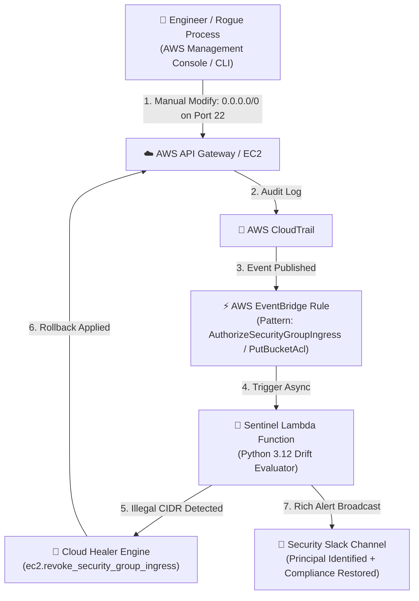

# Cloud Infrastructure Drift Sentinel & Self-Healing Engine 🔄🛡️

> **Event-driven infrastructure governance and automated remediation pipeline** built with AWS EventBridge, CloudTrail, AWS Lambda (Python), Slack Block Kit alerting, and Terraform IaC.

[](https://github.com/TarunKumarPardeshi/cloud-drift-sentinel-self-healing/actions/workflows/ci.yml)
[](https://www.terraform.io/)
[](https://aws.amazon.com/eventbridge/)
[](https://aws.amazon.com/lambda/)
[](https://opensource.org/licenses/MIT)

---

## 📖 Overview

In fast-paced cloud environments, engineers often make manual out-of-band changes directly in the AWS Console (e.g. opening port 22 to `0.0.0.0/0` during an emergency debugging session or turning off S3 Block Public Access). These changes bypass GitOps workflows, creating **configuration drift**, non-compliance, and catastrophic security vulnerabilities.

**Cloud Drift Sentinel & Self-Healing Engine** intercepts out-of-band modifications in real time:
1. **Sub-Second Event Ingestion**: Listens to AWS CloudTrail mutating API calls via **AWS EventBridge**.
2. **Deterministic Baseline Verification**: Evaluates whether an API change violates the security baseline.
3. **Automated Self-Healing Rollback**: Automatically executes an instantaneous rollback (e.g., revokes the open `0.0.0.0/0` security group rule or restores S3 public access locks) in `< 2 seconds`.
4. **Interactive Slack Incident Broadcast**: Posts rich Slack Block Kit notifications attributing the drift to the specific IAM principal, resource ID, timestamp, and action taken.

---

## 🏗️ Architecture & Self-Healing Workflow



---

## 🛡️ Supported Drift Scenarios & Self-Healing Rules

| Drift Scenario | CloudTrail API Trigger | Sentinel Baseline Check | Automated Self-Healing Action |
|---|---|---|---|
| **Security Group Open to World** | `AuthorizeSecurityGroupIngress` | Detects `0.0.0.0/0` or `::/0` CIDRs | Automatically invokes `ec2:RevokeSecurityGroupIngress` to revoke the rule. |
| **S3 Public Access Block Disabled** | `DeletePublicAccessBlock` | Detects removal of account or bucket public locks | Immediately calls `s3:PutPublicAccessBlock` enforcing all 4 block settings. |
| **S3 Bucket ACL Made Public** | `PutBucketAcl` | Detects `AllUsers` or `AuthenticatedUsers` URI grants | Strips public ACL grants and restores private bucket policy. |

---

## 💬 Sample Slack Security Alert

```
🚨 Cloud Security Drift Intercepted & Healed
• Event API: AuthorizeSecurityGroupIngress
• Offending Principal: arn:aws:iam::123456789012:user/developer-manual-change
• Target Resource: sg-01a2b3c4d5e6f7g8h
• Region: ca-central-1

Self-Healing Action Executed:
Revoked 1 open ingress rules: tcp:22-22 (CIDR: 0.0.0.0/0)
Status: COMPLIANCE RESTORED ✅
```

---

## 🚀 Quick Start & Testing

### 1. Set Up Environment

```bash
git clone https://github.com/TarunKumarPardeshi/cloud-drift-sentinel-self-healing.git
cd cloud-drift-sentinel-self-healing

python -m venv .venv
source .venv/bin/activate       # On Windows: .venv\Scripts\activate
pip install -r requirements.txt
```

### 2. Run Local Drift & Remediation Test

Execute the unit test harness simulating CloudTrail event payloads:

```bash
pytest tests/ -v
```

```
tests/test_sentinel_and_remediation.py::test_detect_and_remediate_security_group_drift PASSED
tests/test_sentinel_and_remediation.py::test_detect_and_remediate_s3_public_access_drift PASSED
tests/test_sentinel_and_remediation.py::test_safe_event_ignored PASSED
============================== 3 passed in 1.12s ==============================
```

---

## ☁️ Production Infrastructure as Code (Terraform)

Deploy the EventBridge rule, Lambda function, and IAM least-privilege roles to AWS:

```bash
cd terraform
terraform init
terraform plan
terraform apply
```

Key resources provisioned:
- `aws_cloudwatch_event_rule`: Pattern-matched for mutating EC2 and S3 API events.
- `aws_lambda_function`: Lightweight Python 3.12 execution engine.
- `aws_iam_role`: Least-privilege IAM permissions restricted strictly to security group revocation and S3 access blocking.

---

## 📂 Repository Layout

```
├── .ci/workflows/ci.yml                        # Automated CI workflow
├── src/
│   ├── sentinel/                               # EventBridge ingestion
│   │   └── handler.py                          # Lambda entrypoint & drift evaluation
│   ├── remediation/                            # Self-healing logic
│   │   └── healer.py                           # Boto3 EC2 & S3 automated rollbacks
│   └── notifications/                          # Incident reporting
│       └── slack.py                            # Slack Block Kit alert generator
├── terraform/                                  # Complete IaC deployment
│   ├── main.tf                                 # EventBridge, Lambda & IAM definitions
│   ├── variables.tf                            # Configurable parameters
│   └── outputs.tf                              # Exported ARNs
├── tests/                                      # Pytest unit & drift test suite
├── Dockerfile                                  # Container runtime definition
├── requirements.txt                            # Dependencies
└── README.md
```

---

## 👨‍💻 Author

**Tarun Kumar Pardeshi** — Cloud & DevOps Engineer
- GitHub: [@TarunKumarPardeshi](https://github.com/TarunKumarPardeshi)
- LinkedIn: [tarun-pardeshi](https://www.linkedin.com/in/tarun-pardeshi/)
